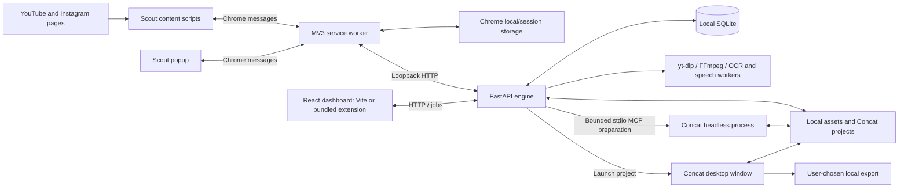

# ShortForge architecture

Updated October 30, 2026. Current implementation after the native Concat transition, performance improvements and the [codebase audit](docs/AUDIT-2026-10-30.md).

ShortForge combines a React dashboard, Chrome MV3 discovery extension and loopback FastAPI engine with local SQLite/media storage; the engine prepares persistent projects and opens native Concat for editing.

## System overview

The dashboard manages discovery, Library data, settings and launch status. The native editor owns timeline editing, saving and exporting. There is no video-streaming browser editor or automatic export-to-publishing connection.

## Components and entry points

| Component | Implementation | Responsibility |
|---|---|---|
| Startup | [start.sh](start.sh), [start.bat](start.bat) | Dependencies, yt-dlp update check, Concat setup, extension build, engine and Vite startup |
| Engine entry | [engine/__main__.py](engine/__main__.py) | Load local environment, discover bundled FFmpeg and run Uvicorn on `127.0.0.1:8787` |
| HTTP application | [app.py](engine/core/app.py) | Lifespan recovery, request-size/host/origin boundaries, CORS and router registration |
| Core API/storage | [routes.py](engine/core/routes.py), [db.py](engine/core/db.py), [models.py](engine/core/models.py) | Validation, Library, uploads, downloads, jobs, settings, asset serving and SQLite helpers |
| Dashboard shell | [App.tsx](dashboard/src/shell/App.tsx), [api.ts](dashboard/src/api.ts) | Navigation, themes, Library/health refresh, job state and asset URL handling |
| Library | [Library.tsx](dashboard/src/library/Library.tsx) | Client-side search/filter/sort, 50-entry pages, selection, bulk actions and import/detail UI |
| Scout extension | [background.ts](extension/src/background.ts), [content.ts](extension/src/content.ts), [instagram.ts](extension/src/instagram.ts), [popup.ts](extension/src/popup.ts) | Persistent session/pending state, page extraction, screening coordination and controls |
| Scout analysis | [scout_routes.py](engine/core/scout_routes.py), [scout_captions.py](engine/studio/scout_captions.py), [scout_speech.py](engine/studio/scout_speech.py) | Bounded temporary downloads, OCR/speech checks and worker cancellation |
| Media | [media.py](engine/core/media.py), [editor_media.py](engine/studio/editor_media.py) | Acquisition, probing, stream normalization and thumbnails; the `editor_media` name survives the old editor |
| Native Studio | [Studio.tsx](dashboard/src/studio/Studio.tsx), [concat.py](engine/core/concat.py), [concat_rpc.py](engine/core/concat_rpc.py) | Current-job launch UI, project preparation, stdio MCP and desktop process launch |
| YouTube services | [youtube_auth.py](engine/core/youtube_auth.py), [youtube_uploads.py](engine/core/youtube_uploads.py) | Channel OAuth and retained upload/recovery backend; channel Settings remain in the UI |
| AI services | [engine/ai/routes.py](engine/ai/routes.py) | Retained rewrite/script/voice/TTS endpoints, without the former dashboard workflow |
| Packaging | [extension/build.mjs](extension/build.mjs), [manifest.json](extension/static/manifest.json) | esbuild/Vite outputs, local dashboard assets, strict MV3 script policy and content-hash build reuse |

## Startup and packaging

The launchers enforce a patched pip version, install Python requirements with security floors, attempt a yt-dlp update, validate npm installations against the lockfiles through [setup-node.mjs](scripts/setup-node.mjs), and run [scripts/setup-concat.py](scripts/setup-concat.py). That setup uses the pinned [release manifest](vendor/concat-release.json), verifies downloads and reuses a working runtime. Matching npm installations are reused; stale or incomplete installs run `npm ci` with development and platform-optional packages included. Dependency/build failures stop startup. It does not install optional speech models. Supported platform paths and setup failures are documented in [docs/CONCAT.md](docs/CONCAT.md).

`npm --prefix extension run build -- --if-needed` still runs the extension type check. `build.mjs` fingerprints source, static files, configuration, package/installed dependency metadata, relevant build environment and generated output. A matching cache under `extension/node_modules/` permits reuse; modified/missing output or a malformed cache rebuilds. An explicit build without the flag always rebuilds. A rebuild bundles content/background/popup scripts, copies static assets, type-checks/builds the dashboard and externalizes inline bootstrap scripts for MV3 CSP.

The Vite dashboard runs at port 5173 and proxies `/api` to the engine. The bundled extension dashboard runs from `extension/dist/dashboard` and resolves its local API URLs to the loopback engine. `api.ts` rewrites returned asset URLs for the extension context and avoids that traversal in the ordinary web context. Build output, runtime binaries, downloaded models and the managed upstream checkout are ignored by Git.

## Data and ownership

`SHORTFORGE_DATA_DIR` selects the storage root; it defaults to repository `data/`. [db.connect()](engine/core/db.py) opens SQLite with foreign keys, WAL and a 30-second connection timeout, applies idempotent schema creation and commits or rolls back the operation. The data directory/database receive restrictive permissions on non-Windows systems. No external database service or connection pool is required.

| Stored data | Owner and purpose |
|---|---|
| `clips` | Source identity, metadata, counts, rights and workflow state; `video_id` is unique when present |
| `assets` | Local files with optional clip ownership; API paths are resolved within the data root |
| `jobs` | In-process work status, progress, errors and result JSON; composite index on `(clip_id, type, status)` |
| `scripts`, `transcripts`, `voices` | Retained core/AI service data |
| `editor_projects` | Historical custom-editor documents; not the native Concat project format |
| `settings` | Local settings and configured provider values; public views redact secrets |
| `youtube_oauth_states`, `youtube_channels`, `youtube_uploads` | Separate OAuth and upload storage initialized by the YouTube modules |
| `concat/projects/<clip-id>/edit/` | Native Concat project, with an independent source copy in sibling `media/` |
| Chrome local/session storage | Scout settings, pending/seen/known IDs and session/account queue state; dashboard preferences/job references use browser storage |

Deleting a Library entry removes its associated Library records/assets, not the independent Concat edit/media. This intentionally uses additional disk space to keep saved edits valid. Native exports use the destination the user chooses in Concat; they are not automatically registered as Library assets or published.

## Execution flows

### Library reads and interaction

1. `App.tsx` loads `/api/clips`. Visible-tab periodic refresh runs every five seconds; health checks run every twelve seconds. In-flight checks are guarded, requests have deadlines and visibility/focus resumes checks. Explicit actions can request a refresh, including a queued refresh during an existing Library request.
2. `routes.list_clips()` validates filters/sort, queries the complete matching list and serializes the public JSON once. A SHA-256 ETag identifies the body. `Cache-Control: private, no-cache` permits storage with revalidation; a matching `If-None-Match` returns `304`.
3. The browser reuses the cached response body. The shell compares the returned clip snapshot before replacing state; unchanged health data likewise retains its object.
4. `LibraryPage` memoizes filtering/sorting, uses sets for selection membership and renders one 50-entry page. Search and counts still use the complete loaded collection. Archive sends at most four concurrent requests; delete sends at most 200 IDs per batch and retains unhandled selection after a failure.

This is **client-side pagination**. The server still reads/serializes the list to calculate its ETag; revalidation saves response payload, not all server work. Cached JSON is still parsed and compared in the browser. Keeping the complete default response preserves Scout's duplicate-detection contract.

### Upload and source acquisition

1. Core upload and AI voice-reference handlers are synchronous FastAPI endpoints, so blocking reads/writes/probes run in the framework's worker pool. Header/content validation, size limits, media probing and cleanup remain at their existing boundaries.
2. `normalize_browser_video()` checks video and audio compatibility independently. Supported H.264/eight-bit `yuv420p` video and AAC audio can be copied; incompatible streams are converted. Generated MP4 output retains faststart and is probed before use. Failed output is removed. Compatible streams do not undergo an extra lossy encode.
3. `/clips/{id}/download` and Concat source preparation share `media.claim_download()`, which probes an existing source before acquiring the SQLite writer transaction. Inside `BEGIN IMMEDIATE`, it checks for an active download, verifies source identity/path/mtime/size, and reuses a valid source or creates one queued job. A changed source returns `409` for retry.
4. `download_job()` acquires through yt-dlp, normalizes/validates the result and registers the asset. Intermediate downloading updates require a changed whole percentage and at least 0.5 seconds since the last written update; completion/failure is written separately.

Studio executes only a download it has newly claimed; otherwise it waits outside transactions for the owner, up to 30 minutes, then validates the source. A wait timeout does not cancel the owner. Transcription and script extraction use `db.new_job(..., unique_active=True)` to atomically reject duplicate active jobs with HTTP 409.

Local media probes, normalization and video thumbnails restrict both protocols and input demuxers. Reference recordings force the accepted audio container, register the asset/profile atomically and remove failed uploads. The checks reject media manifests even when they imitate a video file signature.

Enrichment reads requested clips with one query before preserving input order and provider batches. The async Instagram thumbnail route admits at most three lookups before borrowing default request workers, so queued covers do not occupy the entire pool. Existing cache and retry responses are unchanged.

See [source URL validation](engine/core/source_urls.py), [core tests](engine/core/tests/test_core.py) and [media packet/codec tests](engine/studio/test_media_normalization.py).

### Scout discovery and analysis

1. Content scripts read the active Short/Reel or advance through an account queue. The service worker owns settings/session decisions and checks known, seen and pending IDs. Pending matches are persisted before submission to the engine.
2. For caption screening, `prepareScan` starts `/api/scout/caption-check`; content-side polling uses `captionStatus`, leaving the service-worker message queue available for pause/recovery. Result identity includes the video, session, policy and seconds allowance.
3. The engine admits one caption check at a time, persists its job and starts a bounded worker subprocess. Temporary source/proxy/progress/result files live in a temporary directory. Timeout/cancel terminates the worker process tree and cleanup releases the slot.
4. `brief-only` normalizes a complete video proxy, then decodes forward once. It retrieves the same half-second midpoint samples, includes the final short bin and verifies decoding through the remaining tail. OCR reads the complete sampled frame under the existing thresholds. Parent-side progress writes require a changed whole percentage.
5. `small-text-no-speech` first inspects the original combined video/audio. Speech or unverifiable audio can reject before proxy/OCR work; caption measurements remain null with zero frames. Verified speech absence continues through OCR and the final combined decision.
6. Unchanged caption-progress text does not rewrite extension storage; unchanged badge properties do not repeat badge calls. A per-read Instagram payload cache reuses parsed JSON for counts/cover without caching stale data across subsequent reads. Complete exact counts avoid a DOM count scan.

Uncertain/incomplete analysis never becomes an empty successful reading. Models are local and explicitly installed; network download, model inference and OCR proxy creation remain meaningful costs. See [speech limits](engine/studio/SCOUT_SPEECH.md).

### Native editor handoff

1. A Library click updates the current tab's Studio state and calls `/api/studio/open` with a clip ID. An independent Studio launch uses no clip ID. The backend validates capability and atomically reuses or creates an active launch job.
2. `prepare_project()` reopens an existing `concat.json` unchanged. For a new project it obtains a valid source, copies media independently, and uses `ConcatRPC` to run `Concat --mcp headless` over bounded stdio JSON-RPC.
3. Preparation creates a 1080×1920, 30 fps timeline, imports/places the video, saves and closes it in a staging directory, then renames that completed project into place.
4. `launch_desktop()` starts the native process with the project path, records a local log and checks for an early failure over two seconds. The launch job reports completion with the requested clip and `opened:true`.
5. `StudioPage` accepts only the current requested job's confirmed result. Retry/open-again and Back to Library remain available. Concat owns subsequent editing, saving and export. The browser tab does not own the desktop editor's lifetime.

The two-second launch check is not a test of native editing/export correctness. Keep the media copy and failure detection when optimizing this flow.

## Jobs, recovery and security boundaries

FastAPI background tasks execute inside the engine process; SQLite records state but is not a durable task broker. On startup the application marks interrupted queued/running jobs failed and invokes the YouTube module's distinct upload recovery. Scout additionally has a subprocess, cancellation registry and concurrency slot. There is no global media-job scheduler. The async job event stream delegates database reads to the worker pool and reports terminal state without blocking the event loop on those reads.

The engine binds to loopback, checks Host and browser Origin/cross-site headers, limits declared and streamed request bodies, validates model inputs and constrains asset paths. The Google OAuth callback is a specific exception with its own state/PKCE validation. The extension has local API host permissions and a CSP with locally bundled scripts. These controls describe a local single-user system; they are not multi-user authentication or a public-hosting design.

Provider keys and OAuth credentials stay server-side; public settings/validation errors do not echo their input values. Concat child environments remove configured provider-secret variables. Private data/runtime/model folders remain outside version control. Retained AI and YouTube upload endpoints require their own explicit invocation; no Concat export automatically invokes them.

## Evidence, boundaries and deferred work

[PRD.md](PRD.md) maps required behaviour to tests. [The October 30 audit](docs/AUDIT-2026-10-30.md) and [earlier performance results](docs/PERFORMANCE-RESULTS-2026-10-26.md) record measurements and the distinction between complete workflows and individual stages. [AGENT.md](AGENT.md) provides setup/check commands. [DESIGN.md](DESIGN.md) governs current UI behaviour.

The removed custom editor and streaming implementation appear in the [browser-editor archive](docs/archive/browser-editor/ARCHITECTURE.md). Core/AI files retaining an `editor` name or legacy table do not establish a current browser editor. Optional native-runtime/model checks, live platform calls, Windows execution and native export quality have separate verification requirements.

Server-side pagination/revision tracking, persistent model workers, a global job scheduler, bundle/font restructuring, health-hash caching and a Concat publishing handoff remain deferred. No such service is implied by this architecture diagram.
